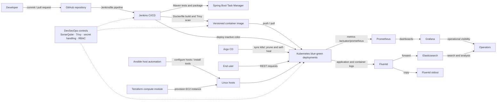

# Task Manager DevOps Architecture

## End-to-end view



The requested high-level handoff is **Developer → GitHub → Jenkins → Docker →
Kubernetes → Monitoring → Logging → End User**. Operationally, the last four
components are related rather than a single request path: end users send API
traffic to Kubernetes, while Kubernetes emits metrics to Prometheus/Grafana and
logs to Fluentd/Elasticsearch.

## ASCII view

```text
                         +--------------------------+
                         | DevSecOps controls       |
                         | SonarQube / Trivy        |
                         | secrets / least privilege|
                         +------------+-------------+
                                      |
                                      v
+-----------+   commit/PR   +---------+--------+   build/test   +---------+
| Developer | ------------> | GitHub          | -------------> | Jenkins |
+-----------+               | source + config |                +----+----+
                            +--------+--------+                     |
                                     ^                        image | deploy
                                     | Argo CD GitOps                v
                                     |                    +----------+----------+
                                     +-------------------> | Kubernetes         |
                                                          | blue <-> green     |
               +----------------+                         +---+-------------+--+
               | Terraform      | provision                    |             |
               | reusable EC2   |                               | API traffic  | metrics
               +-------+--------+                               v             v
                       |                                  +----------+   +----------+
                       v                                  | End user |   | Prometheus|
               +-------+--------+                          +----------+   +-----+----+
               | Linux hosts    |                                       scrape|
               +-------+--------+                                             v
                       ^                                                +-----+----+
               +-------+--------+                                       | Grafana  |
               | Ansible        |                                       +----------+
               | configure/install|                                           ^
               +----------------+                                            |
 Kubernetes/container logs --> Fluentd -------------------------------------+
                                    |           \
                                    v            v
                             Elasticsearch    stdout
```

## Component responsibilities

| Area | Repository artifacts | Responsibility |
|---|---|---|
| Application | [app/](../app/), [Dockerfile](../docker/Dockerfile) | Spring Boot REST API, H2 default/PostgreSQL option, health and Prometheus endpoints, Java 25 runtime image |
| CI/CD | [Jenkinsfile](../jenkins/Jenkinsfile) | Checkout, Maven test/package, image build, Trivy scan, inactive-color deployment, optional traffic switch |
| Runtime | [Kubernetes base](../k8s/base/), [blue overlay](../k8s/overlays/blue/), [green overlay](../k8s/overlays/green/) | API deployments, PostgreSQL, persistent storage, internal service, probes, blue-green labels |
| Traffic | [switch-traffic.sh](../k8s/switch-traffic.sh) | Changes the Service selector only after the selected deployment is ready |
| GitOps | [Argo CD Application](../gitops/argocd-application.yaml) | Watches the repository's `k8s/` path with automated prune and self-heal |
| Host automation | [Ansible](../ansible/) | Configures supported Debian/Ubuntu hosts and installs Docker/Kubernetes node packages |
| Infrastructure | [Terraform](../terraform/) | Reusable AWS EC2 compute module; expects an existing VPC, subnet, and security group |
| Monitoring | [Prometheus](../monitoring-logging/prometheus.yml), [Grafana dashboard](../monitoring-logging/grafana-dashboard.json) | Scrapes application, node-exporter, and cAdvisor metrics; visualizes CPU, memory, HTTP, JVM, and scrape health |
| Logging | [Fluentd](../monitoring-logging/fluentd.conf) | Collects application/container/Kubernetes logs and copies events to Elasticsearch and stdout |
| Security | [DevSecOps guide](../security/devsecops-hardening.md), [SonarQube properties](../security/sonar-project.properties) | Documents static analysis, image scanning, secret controls, container hardening, and access boundaries |

## Deployment boundaries and assumptions

- The GitOps Application uses a placeholder GitHub URL; replace it with the
  actual repository URL before Argo CD sync.
- Jenkins requires configured registry credentials, a cluster context, and
  suitable Docker/Kubernetes tools on its agent. The inventory, database
  credentials, image names, and cloud inputs must also be set for the target
  environment.
- Terraform provisions one EC2 instance in an existing network; it does not
  provision a Kubernetes cluster or its VPC/networking.
- Ansible installs node packages but does not initialize or join a cluster.
- Prometheus static targets and Fluentd mounts/plugins must match the deployed
  monitoring/logging environment. The Fluentd config requires the Kubernetes
  metadata and Elasticsearch plugins.
